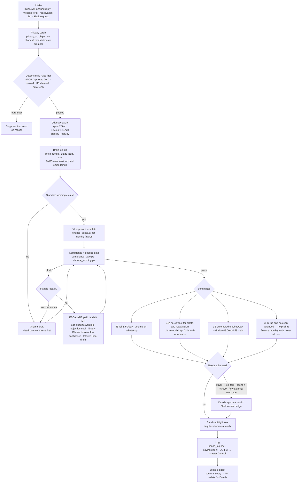

# Process flow: Ollama first (12 Nov 2026)

**Owner:** Master Control · **Applies to:** every MedWave bot, the Mac reply watcher, the box new-lead watcher, and the helper scripts in `tools/ollama_helpers/`.

**The rule** (Davide, 9 and 11 Nov): every task starts with deterministic rules and the brain, then local Ollama. A paid model is used only when Ollama can't do the task. Ollama listens on **127.0.0.1:11434 only**, with no tunnels. Each machine uses its own daemon: the Mac runs `qwen2.5:7b` when it's installed, and the box runs `qwen2.5:3b`.

## Diagram

A rendered copy is in `flow.png`.

## Stages

| # | Stage | Engine | Tool | Output |
|---|---|---|---|---|
| 1 | **Intake**: HighLevel reply, website form, reactivation list, Slack request | Python poll | Mac `lead-watcher`, box `new-lead-watcher`, OC batch builders | Event JSON |
| 2 | **Privacy scrub** | Deterministic | `tools/ollama_helpers/privacy_scrub.py` | Text with no phones, emails, tokens or webhook URLs; safe to put in a prompt |
| 3 | **Hard filters**: STOP, opt-out, DND, booked, US channel, auto-reply, Community group | Regex and lookups | watcher `classify.py`, `tools/ollama_helpers/classify_reply.py` | Drop or continue |
| 4 | **Classify** | **Ollama** | watcher `classify_with_ollama`, `tools/ollama_helpers/classify_reply.py` | Label + confidence |
| 5 | **Brain lookup** | Deterministic (BM25 over the vault) | GLM5 `brain decide / triage-lead / assign / ask` | Rule id, owner, calendar, HQ flag |
| 6a | **Fill a template** when standard wording exists | Deterministic | approved template library, `tools/ollama_helpers/finance_quote.py` | Draft |
| 6b | **Draft** when no template fits | **Ollama**, after Headroom compression | watcher `reply_local.py`, GLM5 `ollama_client` | Draft |
| 7 | **Compliance and dedupe gate** | Deterministic; **Ollama** only in the grey band | `tools/ollama_helpers/compliance_gate.py`, `tools/ollama_helpers/dedupe_wording.py` | pass/block + reasons + `davide-bot-outreach` tag |
| 8 | **Escalation trigger** | — | see below | Paid live-reply routine (MC/OC) |
| 9 | **Send gates** | Deterministic | gate + OC batch scripts | Send / hold |
| 10 | **Human gate** | — | Davide approval card, owner Slack nudge | Approved / held |
| 11 | **Send** | HighLevel (WhatsApp first; email ≤ 50/day) | existing send paths (unchanged) | Message id |
| 12 | **Log** | Deterministic | `sends_log.csv`, `savings.jsonl`, `tools/ollama_helpers/savings_helpers.jsonl` | Audit trail |
| 13 | **Digest** | **Ollama** | `tools/ollama_helpers/summarise.py` | MC bullets for Davide |

## Escalation trigger: when a paid model is allowed

Escalate (`escalate_paid: yes` plus a reason) only when one of these is true:

1. Ollama is down, or the preferred model is missing on every loopback host.
2. Classification confidence is below 0.6, or the label is not in the label set.
3. The reply needs **lead-specific wording**: a clinical question, a custom quote, or an objection that isn't in the approved library.
4. Two local drafts in a row fail the compliance gate.
5. The task needs a tool Ollama can't call: HighLevel MCP reads, calendar booking, Slack or WhatsApp MCP.
6. The input runs past about 6,000 characters after Headroom compression and needs real synthesis, not extraction. The 3B model is reliable at extracting rules and weak at synthesis. The Mac's 7B is better, so run heavy local drafting there.

A **human** flag is not a paid-model flag. Buyers, Red items, spend above R5,000, a new type of external send and open policy gaps all go to Davide.

## Send gates (all must pass)

- No DND, opt-out, suppression or "not interested".
- Not booked. Booked leads are never re-messaged by automation.
- US leads get email only.
- **Email is capped at 50 a day** across the bot runs. Volume goes on WhatsApp.
- **24-hour rule:** blasts and reactivation skip anyone contacted in the last 24 hours. The reactivation batches keep their 48-hour skip. **The one-hour re-touch for brand-new leads is exempt.**
- No more than 3 automated touches a day.
- **No repeated wording** to the same contact.
- **CPD gate:** any `cpd…` tag without `cpd - attended` means no pricing.
- **Price wording:** monthly amounts only. No full price, interest rate, term or deposit.
- WhatsApp texts end on a question, with no name or title sign-off. The opt-out line is "Reply 1 to opt out".
- Tag `davide-bot-outreach` on every contact messaged.
- Main SA bulk window is 09:00–10:59 SAST. Stop on a Meta limit. On "insufficient funds", resend once after 2–5 minutes, then warn Sterrenberg.

## Logging

Every local step appends one JSON line to a savings log with the step, model, characters in and out, and estimated paid tokens avoided. The watchers write `savings.jsonl`, and the helper scripts write `tools/ollama_helpers/savings_helpers.jsonl`. Sends are logged per contactId in the existing CSV logs. OC sends Master Control an FYI with the contactIds.

## What did not change

The live send paths (HighLevel bulk, OC batches, the Mac email script) and the Mac reply watcher are **unchanged**. The new scripts are advisory or pre-send helpers. Wiring them into a live path is a separate step, and it needs OC to own it plus Davide's OK where it changes what gets sent.
